<div align="center">

# Digital Doppelgänger

**ME, BUT DIGITAL.**

A digital version of you — build it from your own memories, then test it against the real you.

[](https://iiiiiiiiiiiiiKK.github.io/digital-doppelganger/)
[](https://github.com/iiiiiiiiiiiiiKK/digital-doppelganger/actions/workflows/ci.yml)
[](./LICENSE)
[](#privacy--security)
[](https://react.dev)

[English](./README.md) · [简体中文](./README.zh-CN.md) · **Author: [𝕏 @0xkillcoin](https://x.com/0xkillcoin)**

</div>

---

## What this actually is

A **local-first web app** that turns scattered self-knowledge into an inspectable *digital twin profile* — and then lets you test how well that profile predicts you.

You answer a short stepped questionnaire, add memories (typed in, or imported as TXT / Markdown / JSON), and the app derives a doppelgänger profile: interest distribution, decision bias, voice, value keywords, plus an explicit **known / unknown** ledger. Then you talk to it, pit it against 8 decision scenarios, and measure the gap between its predictions and your real answers.

> **Honest framing:** this is not a psychological test, not a diagnosis, and not a personality replication engine. Every output is a *speculation derived from data you supplied*. The app says "I don't know" instead of inventing your past. See [Limitations](#known-limitations).

### The core loop

```
认识自己  →  创建分身  →  训练分身  →  测试分身  →  观察变化
know yourself → create → train → test → watch it evolve
```

---

## Table of contents

- [Screenshots](#screenshots)
- [Features](#features)
- [Quick start](#quick-start)
- [How it works](#how-it-works)
- [AI mode (optional)](#ai-mode-optional)
- [Data model & storage](#data-model--storage)
- [Privacy & security](#privacy--security)
- [Testing](#testing)
- [Deployment](#deployment)
- [Project structure](#project-structure)
- [Known limitations](#known-limitations)
- [Roadmap](#roadmap)
- [Contributing](#contributing)
- [License](#license)

---

## Screenshots

All screenshots below are captured by the automated Playwright suite against the **production build** in this repository — no mockups, no stock imagery.

| Landing | Doppelgänger profile |
| :---: | :---: |
| 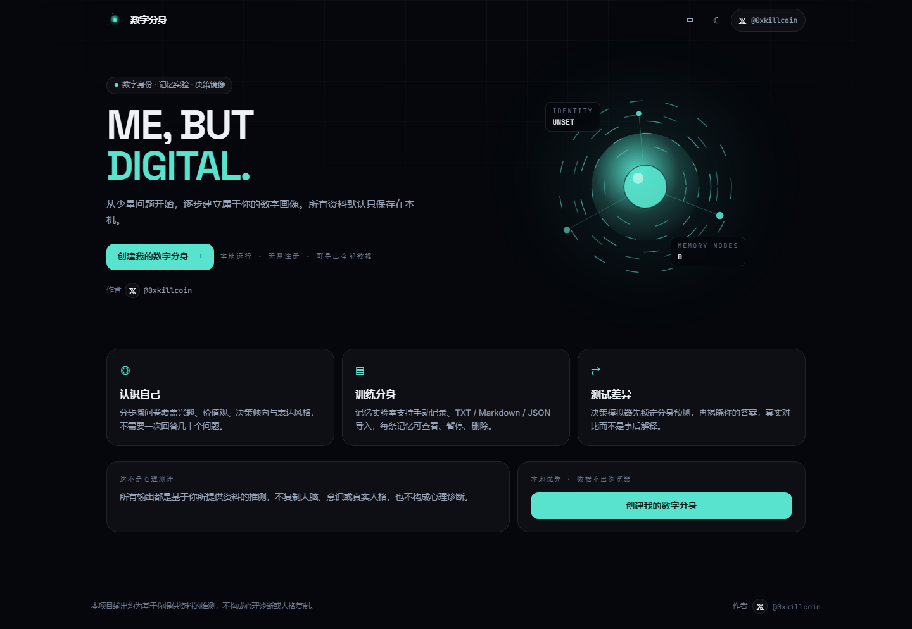 | 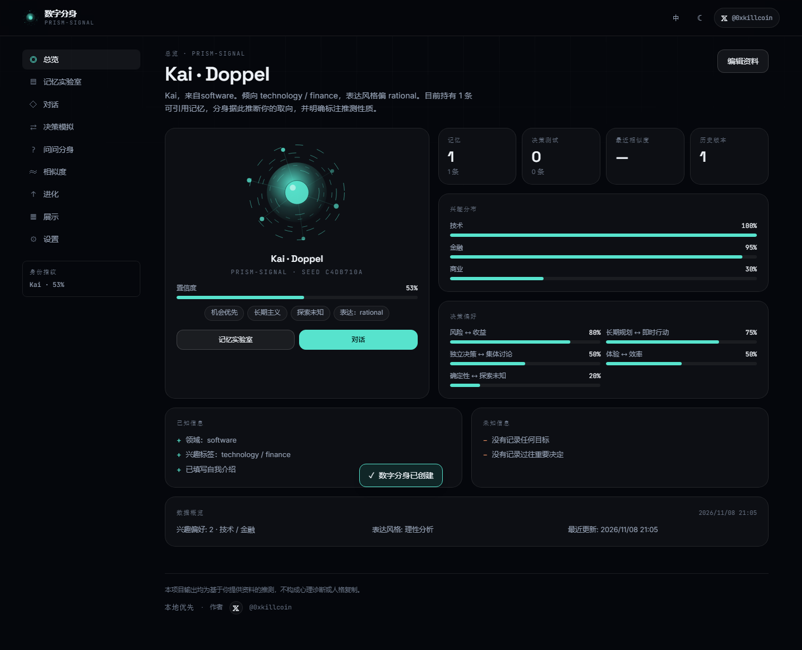 |

| Memory Lab | Chat with citations |
| :---: | :---: |
| 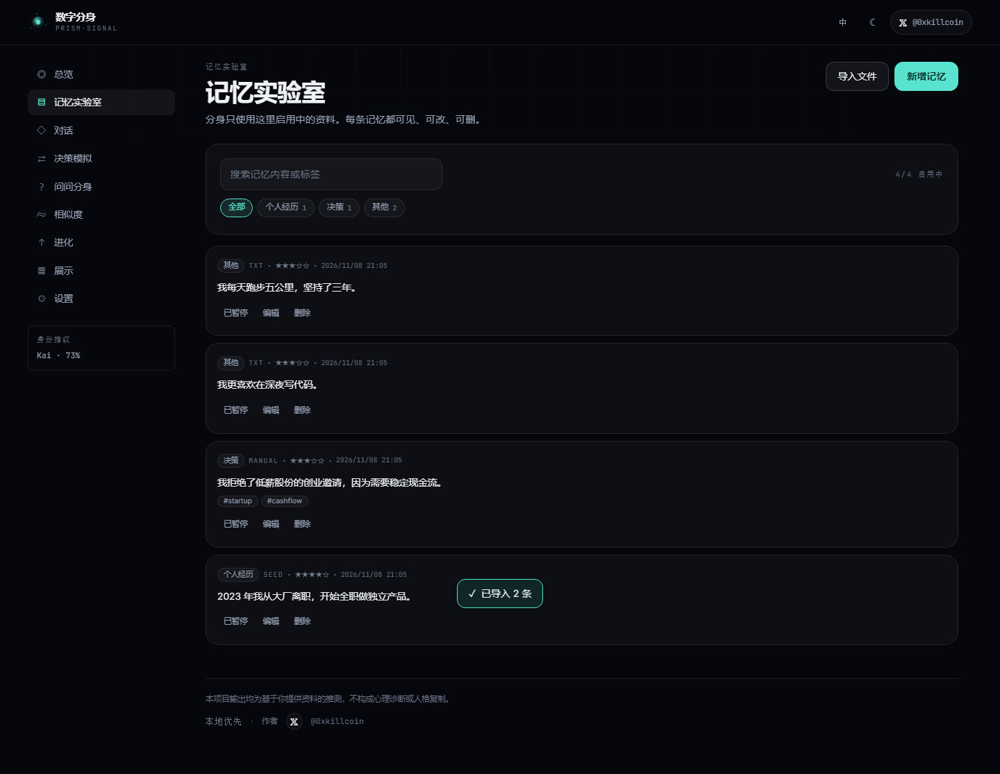 | 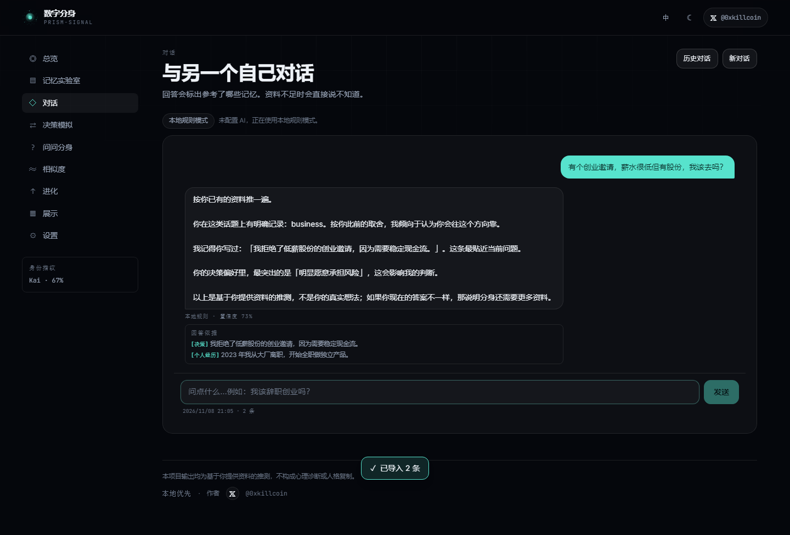 |

| Decision simulator | Similarity report |
| :---: | :---: |
| 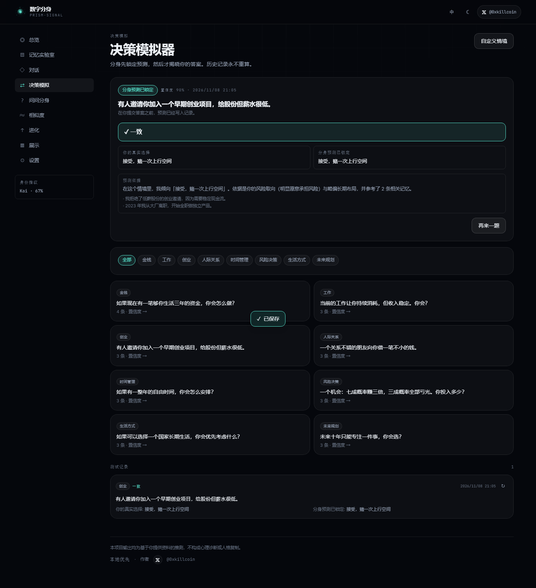 | 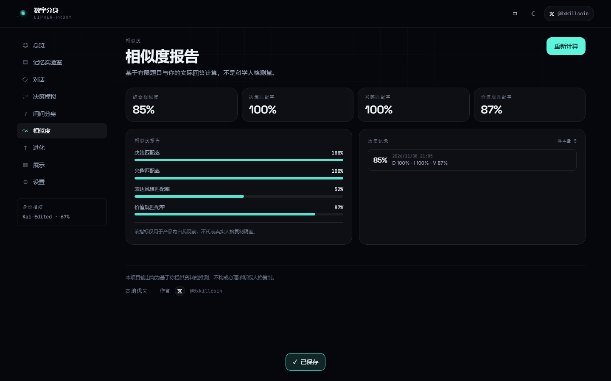 |

| Evolution / versions | Light theme + settings |
| :---: | :---: |
| 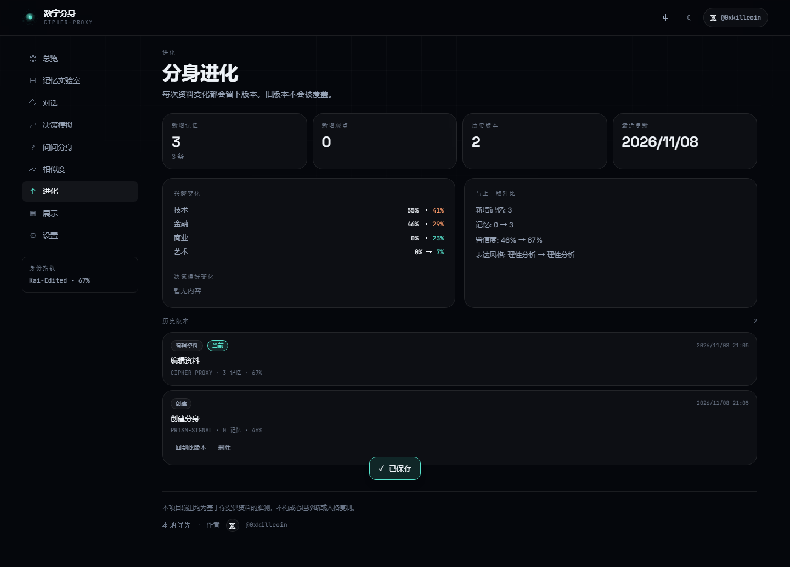 | 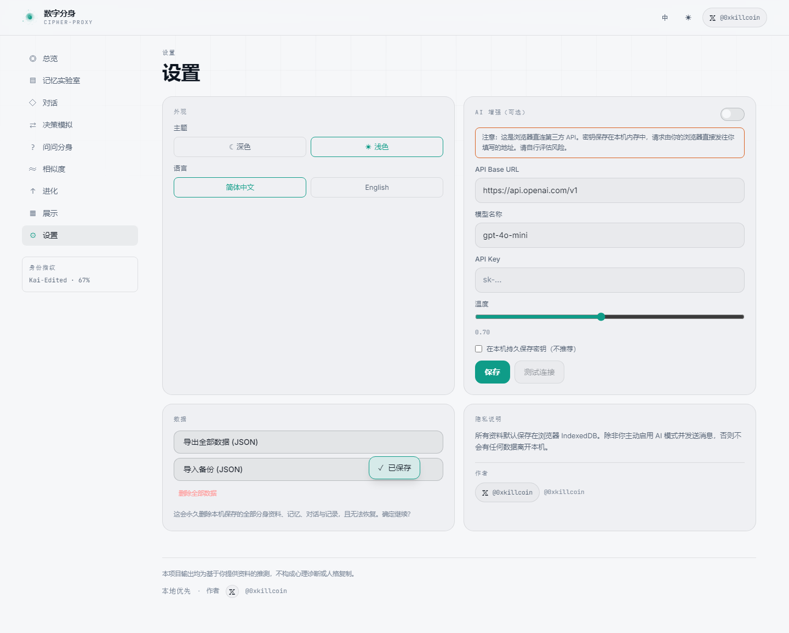 |

| Mobile — landing | Mobile — app shell |
| :---: | :---: |
| 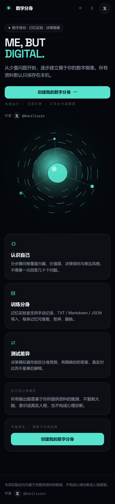 | 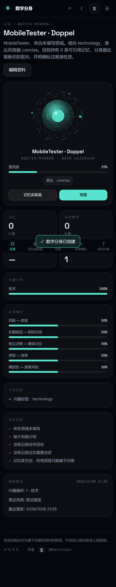 |

---

## Features

### 1. Stepped creation wizard
Six small steps instead of a wall of questions: basics → interests → decision bias → voice → seed memories → review. Non-essential fields are skippable. Progress is visible, and every step is keyboard-navigable.

### 2. Doppelgänger Profile
A generated identity card, not a chat window:

- **Deterministic identity mark** — an SVG "identity orb" derived from a hash of your profile, so the same person always gets the same fingerprint (no random webcam-style avatars).
- Interest distribution, decision-bias bars, value keywords, confidence meter.
- **Known / unknown ledger** — an explicit list of what the app *does not* know about you. This is a first-class feature, not a debug panel.
- Fully editable at any time; every edit creates a new version snapshot.

### 3. Memory Lab
- Manual entry with category, importance (1–5), tags and an enable/disable switch.
- Import **TXT**, **Markdown**, or **JSON** (a backup bundle, an array of memories, or `{ memories: [...] }`).
- Search across content and tags; filter by category; pause a memory to remove it from reasoning without deleting it.
- **Every memory is visible.** Nothing is silently absorbed into an invisible store — that is a hard product rule.

### 4. Talk to Yourself
- Replies carry a **"Based on"** block listing the exact memories cited.
- If nothing matches, it says *"I don't yet know your stance on this"* — it never fabricates your history.
- Two modes: **Local Rules** (deterministic, offline, zero cost) and **AI Enhanced** (your own OpenAI-compatible endpoint).
- Conversation history is stored, listable and deletable.

### 5. Decision Simulator
8 built-in scenarios across money, work, startup, relationships, time, risk, lifestyle and future — plus user-defined custom scenarios.

The anti-cheat design is the point:

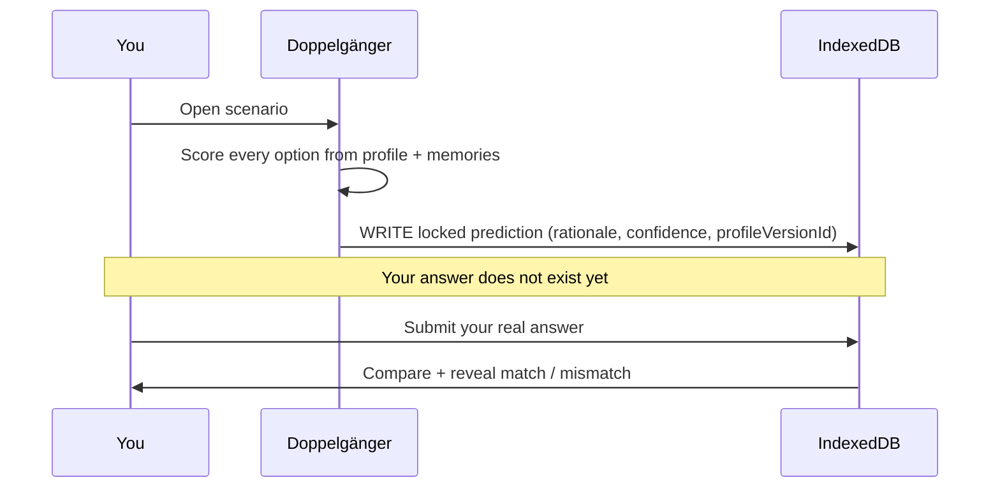

The prediction is committed to storage **before** the answer UI is even shown, and historical records are never recomputed when you later edit your profile.

### 6. Ask My Doppelgänger
Describe any situation — *"should I quit and start a company?"* — and get a structured answer with four separate blocks: **judgement**, **sources used**, **reasoning**, and **open variables**. Answers with thin evidence are explicitly downgraded in confidence.

### 7. Doppelgänger Score
Four dimensions — decision match, interest match, voice match, value match — computed from your real answers, with sample size shown and a permanent reminder that this is a product metric, not psychometrics.

### 8. Evolution
- New memories, new opinions, interest shift (with before → after percentages), decision-bias drift.
- Full version history with **restore**. Restoring never destroys the intervening versions.

### 9. Gallery
Private by default. Generating a public card is an explicit action, exposes at most 5 memories **you** select, and produces a downloadable JSON card. There is no fake "global community" — this build has no backend and says so.

### 10. Craft details
Dark and light themes, a full **English / 简体中文** switch, `prefers-reduced-motion` support, visible focus rings, skip-to-content link, safe-area insets on iOS, and a bottom tab bar sized for thumbs (≥ 44 px targets).

---

## Quick start

```bash
git clone https://github.com/iiiiiiiiiiiiiKK/digital-doppelganger.git
cd digital-doppelganger

npm install
npm run dev          # http://localhost:5173
```

Build and preview the production bundle:

```bash
npm run build
npm run preview
```

Verify everything the CI verifies:

```bash
npm run verify       # typecheck + lint + unit tests + production build
```

### Requirements

- Node.js **20+** (developed and tested on Node 24)
- Any modern browser with IndexedDB (Chrome / Edge / Safari / Firefox)

No API key, no account, no server, no database service.

---

## How it works

```
┌──────────────────────────────────────────────────────────────┐
│  React 18 + TypeScript + Vite                                │
│                                                              │
│  pages/ ──── UI (routing via HashRouter)                     │
│  store/ ──── Zustand: single source of truth + persistence    │
│  lib/   ──── derivation, rule engine, similarity, ai client   │
│  data/  ──── Zod schemas, Dexie database, scenario catalogue  │
└───────────────────────────┬──────────────────────────────────┘
                            │
                     Dexie (IndexedDB)
                            │
        profile · memories · conversations · decisions
                 similarities · versions · settings
```

### Profile derivation (`src/lib/profile.ts`)

Pure functions, no side effects, fully unit-tested:

1. **Interest weights** — questionnaire selections are weighted together with keyword hits from your field, bio, memories and memory tags, then normalised into a distribution.
2. **Decision bias** — five axes (`risk`, `horizon`, `autonomy`, `efficiency`, `certainty`) from sliders plus memory keywords.
3. **Values** — readable keywords derived from axis extremity (e.g. `Upside-first`, `Long-horizon`).
4. **Confidence** — grows with field completeness, interest count, enabled-memory count and category diversity, hard-capped at 0.95.
5. **Known / unknown** — computed gaps, e.g. *"No goals recorded"*.

### Rule engine (`src/lib/brain.ts`)

Deterministic and inspectable — this is what makes the app work with zero configuration:

- **Tokenisation** handles Latin words *and* CJK (character + bigram grams), so Chinese input retrieves correctly.
- **Relevance** = token overlap + shared interest signals + importance nudge.
- **Retrieval gate** — if no memory clears the threshold and no interest matches, the answer is the explicit "I don't know" path with confidence `0.12`.
- **Option scoring** for scenarios blends decision-axis distance, interest weight, and memory support.

### AI client (`src/lib/ai.ts`)

- OpenAI-compatible `POST {baseUrl}/chat/completions`, browser-direct.
- **Prompt-injection defence**: memory text is labelled *untrusted data*, control tags are stripped, `ignore previous instructions` patterns are neutralised, and the system prompt forbids treating memory content as instructions.
- **Confidence ceiling rule** is written into the system prompt (0 relevant memories → cap 0.3).
- Hard failure (network, HTTP error, timeout, unparseable JSON) **falls back to the local rule answer** and shows the error — it never shows a fake success.

---

## AI mode (optional)

AI is an enhancement, never a requirement.

1. Open **Settings → AI enhancement**.
2. Fill in **API base URL** (e.g. `https://api.openai.com/v1`), **model** (e.g. `gpt-4o-mini`) and your **API key**.
3. Toggle the switch on, then use **Test connection** to verify.
4. Any OpenAI-compatible provider works (OpenAI, Groq, Together, OpenRouter, a local Ollama/LM Studio gateway, …).

> ⚠️ **Read this before enabling.** There is no backend in this project, so your browser calls the provider **directly**. The key lives in page memory, is sent only to the URL you type, and is **never persisted** unless you explicitly tick "Persist key on this device". Nothing is ever committed to this repository. If you want a server-side proxy, that is a fork-level change — see [Roadmap](#roadmap).

Costs: AI mode consumes **your** provider quota. The default rules mode is free and offline forever.

---

## Data model & storage

All state lives in **IndexedDB** via Dexie, database name `digital-doppelganger`.

| Table | Key | Purpose |
| --- | --- | --- |
| `profile` | `id: 'me'` | UserProfile (one row) |
| `memories` | `id` | Memory rows, indexed by category / enabled / createdAt |
| `conversations` | `id` | Chat sessions with messages + citations |
| `decisions` | `id` | Locked predictions + your answers |
| `similarities` | `id` | Computed similarity snapshots |
| `versions` | `id` | Immutable ProfileVersion snapshots |
| `settings` | `id: 'settings'` | Language, theme, AI config (key stripped unless opted in), privacy flags |

TypeScript interfaces live in [`src/types.ts`](src/types.ts); the Zod contract that guards **every** import lives in [`src/data/schema.ts`](src/data/schema.ts).

### Import / export

- **Export everything** → `doppelganger-backup-*.json` (`kind: "doppelganger-backup"`), including versions and settings, with the API key excluded by construction.
- **Import backup** → validated by Zod before a single row is written. A malformed file is rejected with the failing path (`memories.3.category: Invalid enum value`), not partially imported.
- **Memory-only import** accepts `.txt`, `.md`, `.markdown`, `.json`; files are capped at 2 MB and JSON memory rows are schema-checked.

---

## Privacy & security

| Principle | Implementation |
| --- | --- |
| Local by default | Everything in IndexedDB. No telemetry, no analytics, no cookies, no remote logging. |
| No default upload | Network requests happen **only** in AI mode, only to the URL you configure. |
| Private doppelgänger | Gallery card generation is opt-in and per-select; ≤ 5 memories, chosen by you. |
| No sensitive data in URLs | Routing is hash-based and carries no user content. |
| No secrets in the repo | `.env.example` ships placeholder names only; the AI key is runtime input. |
| Full visibility | Memory Lab lists 100 % of stored memories with pause/delete controls. |
| Full deletion | Settings → Delete all data wipes every table, then re-seeds default settings. |
| Injection resistance | Memory text is untrusted input in AI prompts; instructions inside it are stripped. |
| Input validation | Zod on every import path; file type and size checks; `importance` bounded 1–5. |
| No HTML injection | React escapes all rendered content; no `dangerouslySetInnerHTML` anywhere. |

**Threat model note.** This is a single-user, no-backend app: there is no auth surface, no server to breach, no shared database. The residual risks are (a) a malicious file you import — mitigated by strict schema validation and text-only rendering, and (b) your own AI provider receiving prompts — which you opt into explicitly.

---

## Testing

```bash
npm run typecheck    # tsc --noEmit, strict mode, zero errors
npm run lint         # ESLint, zero warnings
npm test             # 19 unit tests (Vitest + jsdom + fake-indexeddb)
npm run build        # production bundle
```

### Unit tests — 19 passing

`src/tests/brain.test.ts` (8)
- profile derivation produces interests, bounded confidence, and explicit unknowns
- confidence rises as memories are added
- **rule engine admits "I don't know"** when evidence is absent
- citations only reference real, existing memory ids
- **disabled memories are never retrieved**
- **deleted memories stop being cited**
- predictions are deterministic across repeated calls
- a risk-tolerant and a cautious profile disagree on the all-in bet

`src/tests/data.test.ts` (7)
- backup accepted when well-formed; rejected with a path when a row is broken
- unknown enum values rejected rather than coerced
- memories-array import parsed
- plain-text splitter respects paragraph boundaries
- similarity returns zero and flags unavailable dimensions with no data
- matching predictions score 1.0 decision match

`src/tests/ui.test.tsx` (4)
- author X link points to `https://x.com/0xkillcoin`, opens `_blank` with `noopener`, renders `𝕏`
- app shell renders the top bar, the X link and primary navigation
- language toggle flips store state
- identity orb is byte-for-byte deterministic for a given seed

### End-to-end — 33/33 checks passing

`scripts/e2e.mjs` drives real Chromium against `vite preview` and asserts:

landing renders · X link presence/href/glyph/target · wizard creates a doppelgänger · seed memory persists · add memory · search filters · pause toggles · TXT import · two-step delete removes the row · chat returns citations · chat refuses to invent · **prediction locked before answer** · options selectable · comparison rendered · **decision history survives a profile edit** · similarity renders and recalculates · version history recorded · gallery private by default · public card is opt-in · light theme applies · language switch updates `document.lang` · export produces a valid backup · IndexedDB survives reload · **mobile: no horizontal overflow (landing + shell)** · mobile X link visible · bottom tab bar visible · **mobile tap targets ≥ 44 px** · zero uncaught errors and zero console errors on both desktop and mobile.

```bash
npm run build
npx vite preview --port 4173 &
node scripts/e2e.mjs
```

---

## Deployment

The output is a static bundle — it runs anywhere.

### GitHub Pages (used for the live demo)

`.github/workflows/deploy-pages.yml` builds and publishes `dist/` on every push to `main`.

- Repository → **Settings → Pages → Source: GitHub Actions**.
- `VITE_BASE` defaults to `/digital-doppelganger/`; for a custom domain set `VITE_BASE=/` in the workflow.

### Cloudflare Pages

| Setting | Value |
| --- | --- |
| Build command | `npm run build` |
| Output directory | `dist` |
| Environment variable | `VITE_BASE=/` |

### Vercel

Framework preset **Vite**, build `npm run build`, output `dist`, `VITE_BASE=/`.

### Any static host / self-hosted

Upload `dist/`. Routing is hash-based, so no rewrite rules are needed.

---

## Project structure

```
digital-doppelganger/
├── .github/workflows/       # ci.yml (typecheck+lint+test+build), deploy-pages.yml
├── docs/screenshots/        # real captures from the automated E2E run
├── public/favicon.svg
├── scripts/e2e.mjs          # Playwright end-to-end suite
├── src/
│   ├── components/
│   │   ├── AppShell.tsx     # top bar (with 𝕏 link), sidebar, mobile tabs + drawer
│   │   ├── IdentityOrb.tsx  # deterministic SVG identity mark
│   │   ├── Toast.tsx
│   │   ├── XLink.tsx        # author link, single source of truth
│   │   └── ui.tsx           # PageHeader / Panel / Stat / Meter / Field / ConfirmButton
│   ├── data/
│   │   ├── db.ts            # Dexie schema
│   │   ├── scenarios.ts     # 8 built-in decision scenarios
│   │   └── schema.ts        # Zod contracts for every import path
│   ├── i18n/{dict.ts,useI18n.ts}
│   ├── lib/
│   │   ├── ai.ts            # OpenAI-compatible client + injection defence
│   │   ├── brain.ts         # retrieval, rule answers, option scoring
│   │   ├── cn.ts            # clsx-style helper, clamp, pct, dates
│   │   ├── id.ts            # uid + deterministic hash32
│   │   ├── io.ts            # file import, backup/card builders, download
│   │   ├── profile.ts       # derivation of the doppelgänger profile
│   │   └── similarity.ts    # style signature + 4-dimension scoring
│   ├── pages/               # Landing, Wizard, Overview, MemoryLab, Chat, Ask,
│   │                        # Decisions, Similarity, Evolution, Gallery, Settings
│   ├── store/useApp.ts      # Zustand store, all mutations + persistence
│   ├── tests/               # Vitest suites + setup
│   ├── App.tsx, main.tsx, styles.css, types.ts
├── .env.example
├── LICENSE
├── README.md / README.zh-CN.md
└── package.json
```

---

## Known limitations

Documented honestly, because pretending otherwise would defeat the product's own premise.

1. **Not science.** The similarity score is a product metric computed from a handful of scenarios. It does not measure personality, and the UI says so on every screen that shows it.
2. **Rules mode is shallow by design.** It is retrieval + weighted preferences, not reasoning. Richer self-understanding requires AI mode or more memories.
3. **No backend, no sync, no accounts.** Data is per-browser. Clearing site data deletes it — export a backup first.
4. **Browser-direct AI calls.** With no proxy, an XSS or a hostile browser extension could read the key while it is in memory. The key is never persisted by default, and a proxy is a documented fork-level improvement.
5. **Keyword-based retrieval.** Paraphrase-heavy memories may not match; CJK bigram tokenisation is a pragmatic approximation, not a proper tokenizer.
6. **Custom scenarios are binary** (two options) and use generic axis weights rather than per-option modelling.
7. **No automated a11y audit** (no axe-core in CI). Focus rings, reduced-motion, labels and tap-target sizing are implemented and manually verified, but a formal WCAG pass is outstanding.
8. **Bundle is a single chunk** (~147 kB gzipped). Route-level code splitting is a pending optimisation.

---

## Roadmap

- [ ] Optional server proxy (Cloudflare Worker / Vercel Function) so AI keys never touch the browser
- [ ] Route-level code splitting + bundle budget in CI
- [ ] axe-core accessibility checks in the E2E suite
- [ ] Per-option modelling for custom scenarios (more than 2 choices)
- [ ] Encrypted export (passphrase-protected backup)
- [ ] Import from common note formats (Bear / Obsidian front-matter)
- [ ] Optional WebDAV / user-provided endpoint sync

---

## Contributing

Issues and PRs are welcome.

```bash
npm install
npm run verify      # must pass before a PR is reviewable
```

Please keep three invariants intact, because they are the product:

1. **Never fabricate a user's history.** Unsupported answers must degrade to "I don't know".
2. **Never recompute a locked prediction.** History is evidence of a real prediction.
3. **Never hide a stored memory.** Everything saved must be listable and deletable.

---

## License

[MIT](./LICENSE) © 2026 KK — see the dependency licences in `package.json` (all MIT / ISC / Apache-2.0 compatible).

---

<div align="center">

**ME, BUT DIGITAL.**

Built by **[𝕏 @0xkillcoin](https://x.com/0xkillcoin)**

All output is speculation from data you supplied — not diagnosis, not personality replication.

</div>
