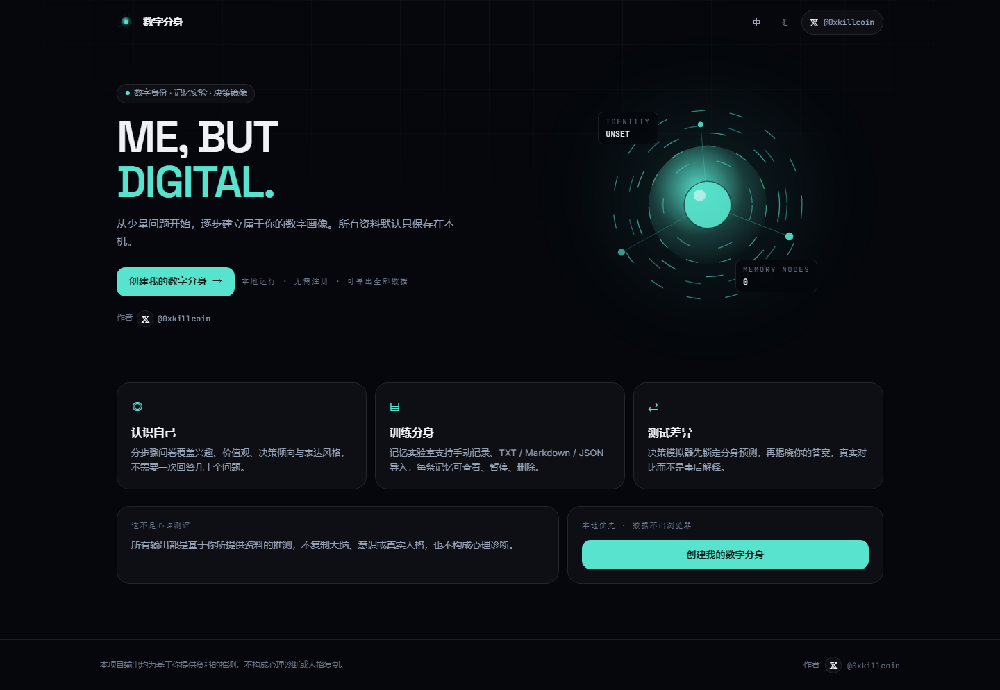
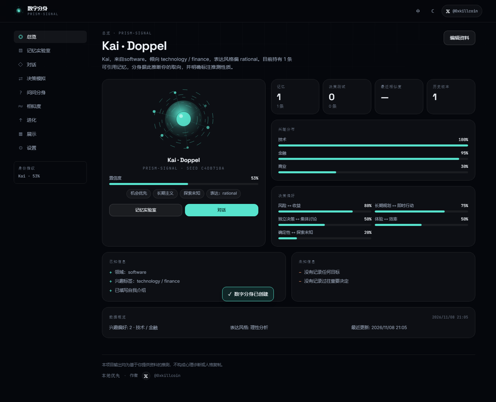
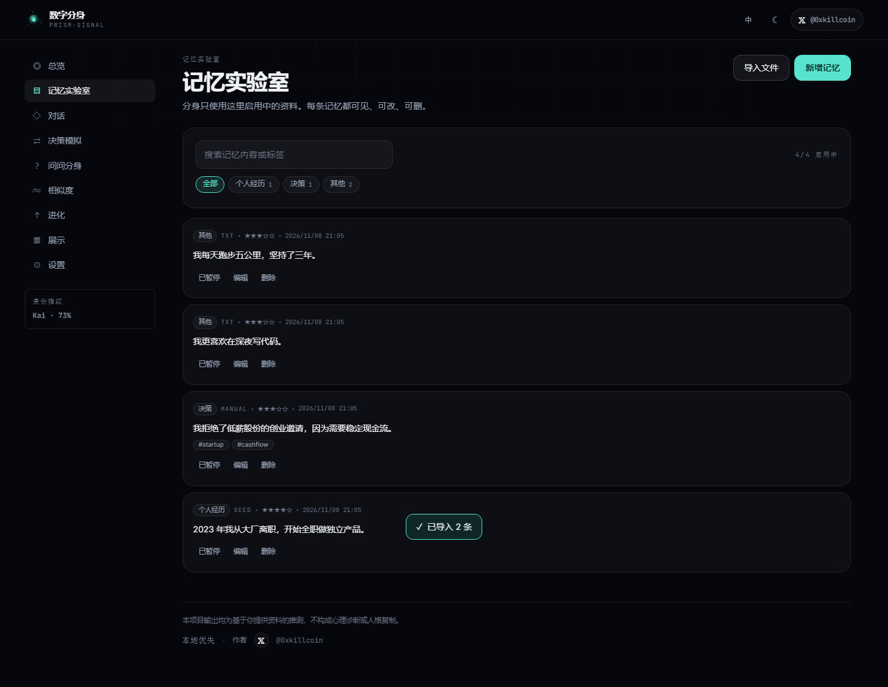
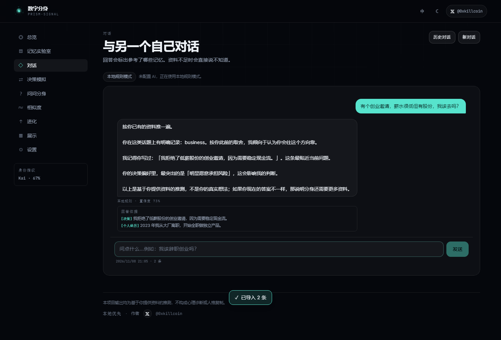
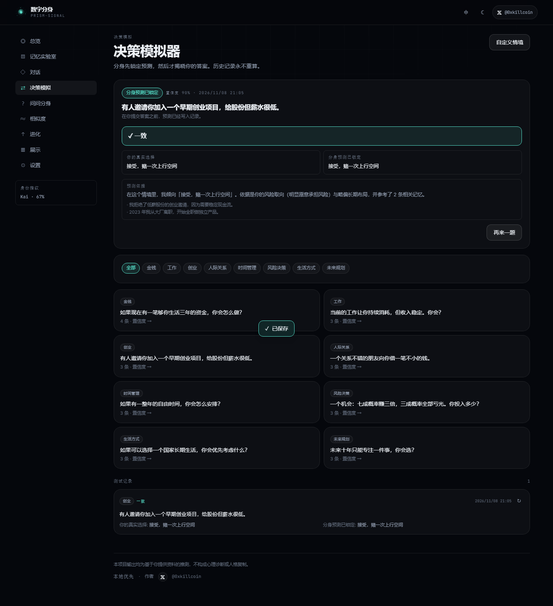
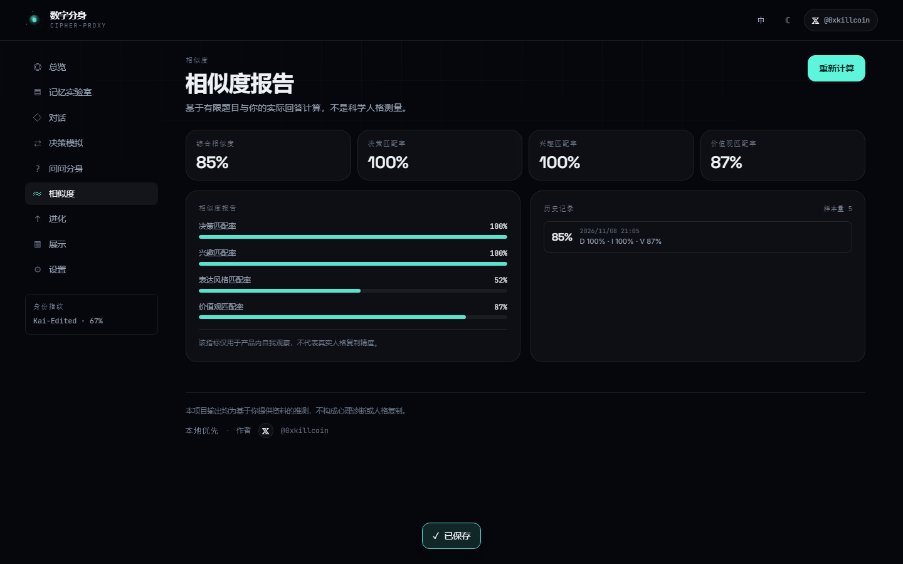
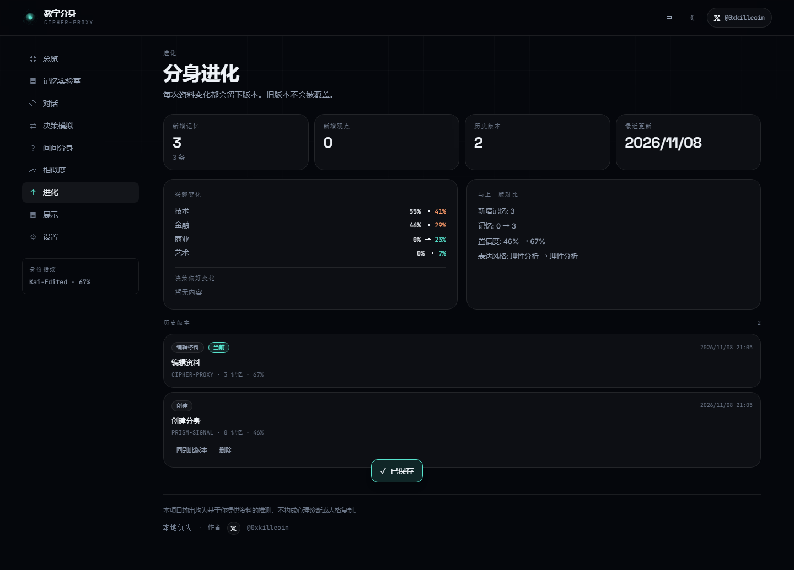
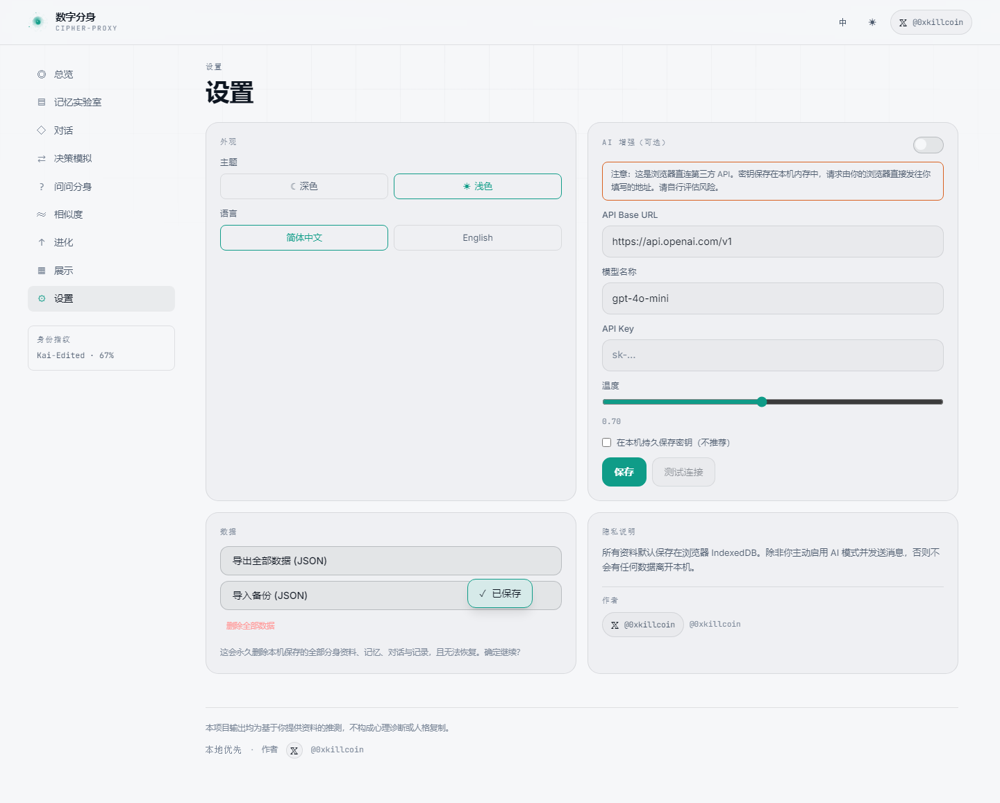
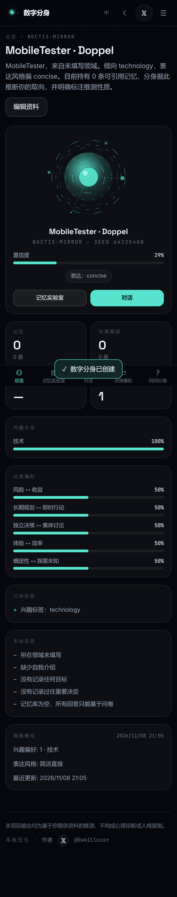
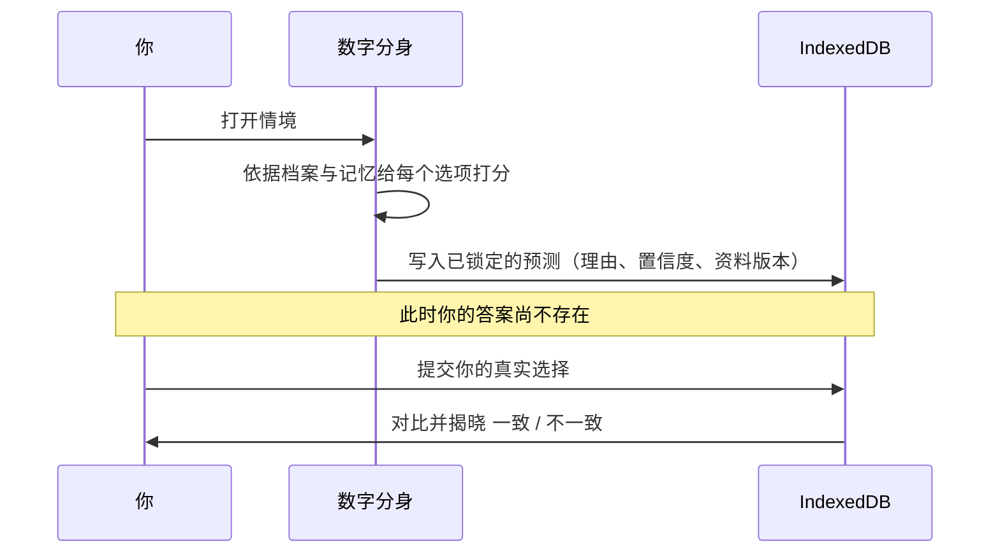

<div align="center">

# 数字分身 · Digital Doppelgänger

**ME, BUT DIGITAL.**

让数字世界拥有另一个你 —— 用自己的记忆建立一个数字分身，再拿它来对照真实的你。

[](https://iiiiiiiiiiiiiKK.github.io/digital-doppelganger/)
[](https://github.com/iiiiiiiiiiiiiKK/digital-doppelganger/actions/workflows/ci.yml)
[](./LICENSE)
[](#隐私与安全)
[](https://react.dev)

[English](./README.md) · **简体中文** · 作者：[𝕏 @0xkillcoin](https://x.com/0xkillcoin)

</div>

---

## 这到底是什么

一个 **Local-first（本地优先）的 Web 应用**：把散落的自我认知整理成一份*可检查的数字分身档案*，然后用它来检验——它到底有多像你。

你填写一份简短的分步问卷，添加记忆（手写，或导入 TXT / Markdown / JSON），应用会推导出分身档案：兴趣分布、决策偏好、表达风格、价值观关键词，以及一份明确的 **已知 / 未知清单**。然后你可以和它对话、让它在 8 个决策情境里下判断，并测量它的预测与你的真实选择之间的差距。

> **诚实说明：** 这不是心理测试，不是心理诊断，也不是人格复制引擎。所有输出都是*基于你所提供资料的推测*。资料不足时，它会直接说"我还不知道"，而不是凭空编造你的经历。详见[已知限制](#已知限制)。

### 核心动线

```
认识自己  →  创建分身  →  训练分身  →  测试分身  →  观察变化
```

---

## 目录

- [界面截图](#界面截图)
- [功能](#功能)
- [快速开始](#快速开始)
- [工作原理](#工作原理)
- [AI 模式（可选）](#ai-模式可选)
- [数据模型与存储](#数据模型与存储)
- [隐私与安全](#隐私与安全)
- [测试](#测试)
- [部署](#部署)
- [项目结构](#项目结构)
- [已知限制](#已知限制)
- [后续计划](#后续计划)
- [贡献](#贡献)
- [许可证](#许可证)

---

## 界面截图

以下截图全部由自动化 Playwright 测试套件针对本仓库的**生产构建**真实截取——没有效果图，没有素材图。

| 首页 | 分身档案 |
| :---: | :---: |
|  |  |

| 记忆实验室 | 带引用来源的对话 |
| :---: | :---: |
|  |  |

| 决策模拟器 | 相似度报告 |
| :---: | :---: |
|  |  |

| 进化与版本 | 浅色主题 + 设置 |
| :---: | :---: |
|  |  |

| 移动端 · 首页 | 移动端 · 系统内页 |
| :---: | :---: |
|  |  |

---

## 功能

### 1. 分步创建向导
六个小步骤，而不是一次几十道题：基本信息 → 兴趣偏好 → 决策偏好 → 表达风格 → 种子记忆 → 生成。非必要字段可跳过，进度可见，全程键盘可用。

### 2. Doppelgänger Profile（分身档案）
一张生成出来的身份档案，而不是一个聊天窗：

- **确定性身份指纹** —— 由资料哈希推导出的 SVG「identity orb」，同一个人永远得到同一个图谱（不是随机换头像）。
- 兴趣分布、决策偏好条、价值观关键词、置信度仪表。
- **已知 / 未知清单** —— 明确列出应用*不知道*你什么。这是一等功能，不是调试面板。
- 可随时编辑，每次编辑都会生成新的版本快照。

### 3. Memory Lab（记忆实验室）
- 手动添加记忆，含分类、重要度（1–5）、标签、启用开关。
- 导入 **TXT**、**Markdown**、**JSON**（备份包、记忆数组，或 `{ memories: [...] }`）。
- 按内容与标签搜索；按分类筛选；可「暂停」某条记忆（不删除但不再参与推理）。
- **每条记忆都可见。** 不存在偷偷吸收进隐藏库的黑盒——这是产品硬规则。

### 4. Talk to Yourself（与另一个自己对话）
- 回答附带 **「回答依据」** 区块，列出被引用的具体记忆。
- 没有匹配资料时，直接回答*「我目前还不了解你在这个问题上的倾向。」*——绝不编造你的人生。
- 两种模式：**本地规则**（确定性、离线、零成本）与 **AI 增强**（你自己的 OpenAI 兼容端点）。
- 对话记录可保存、可切换、可清空。

### 5. Decision Simulator（决策模拟器）
覆盖金钱、工作、创业、人际关系、时间、风险、生活方式、未来规划 8 类内置情境，另支持自定义情境。

防作弊设计才是重点：



预测在你看到选项之前就已写入存储；日后你修改资料，历史记录也**永不重算**。

### 6. Ask My Doppelgänger（问问分身）
输入任意情境——*「我应该辞职创业吗？」*——得到四个独立区块：**分身的判断**、**参考的个人资料**、**推测理由**、**不确定因素**。资料不足时，置信度会被明确压低。

### 7. Doppelgänger Score（相似度）
四个维度——决策匹配率、兴趣匹配率、表达风格匹配率、价值观匹配率——全部基于你的真实回答计算，并展示样本量，且每处都标注：这是产品内部指标，不是心理测量。

### 8. Evolution（分身进化）
- 新增记忆、新增观点、兴趣变化（含前后百分比）、决策偏好漂移。
- 完整版本历史与**回滚**。回滚不会摧毁中间产生的版本。

### 9. Gallery（分身展示）
默认私密。生成公开卡片是一个明确动作，最多只暴露**你自己挑选的** 5 条记忆，并生成可下载的 JSON 卡片。本项目没有后端，因此页面明确写出：不存在全球社区。

### 10. 细节打磨
深浅双主题、完整 **中文 / English** 切换、支持 `prefers-reduced-motion`、可见焦点环、跳转到主内容链接、iOS 安全区适配、为拇指设计（≥ 44px）的底部标签栏。

---

## 快速开始

```bash
git clone https://github.com/iiiiiiiiiiiiiKK/digital-doppelganger.git
cd digital-doppelganger

npm install
npm run dev          # http://localhost:5173
```

构建并预览生产包：

```bash
npm run build
npm run preview
```

执行与 CI 完全一致的校验：

```bash
npm run verify       # 类型检查 + Lint + 单元测试 + 生产构建
```

### 环境要求

- Node.js **20+**（在 Node 24 上开发与测试）
- 任何支持 IndexedDB 的现代浏览器（Chrome / Edge / Safari / Firefox）

不需要 API Key、不需要账号、不需要服务器、不需要数据库服务。

---

## 工作原理

```
┌──────────────────────────────────────────────────────────────┐
│  React 18 + TypeScript + Vite                                │
│                                                              │
│  pages/ ──── 界面（HashRouter 路由）                          │
│  store/ ──── Zustand：单一数据源 + 持久化                      │
│  lib/   ──── 推导、规则引擎、相似度、AI 客户端                  │
│  data/  ──── Zod 契约、Dexie 数据库、情境目录                   │
└───────────────────────────┬──────────────────────────────────┘
                            │
                     Dexie（IndexedDB）
                            │
        profile · memories · conversations · decisions
                 similarities · versions · settings
```

### 档案推导（`src/lib/profile.ts`）

纯函数、无副作用、全部有单元测试：

1. **兴趣权重** —— 问卷选择与「领域、简介、记忆内容、记忆标签」中的关键词命中共同加权，归一化为分布。
2. **决策偏好** —— `risk`、`horizon`、`autonomy`、`efficiency`、`certainty` 五轴，来自滑块与记忆关键词。
3. **价值观** —— 由各轴偏离程度推导出可读关键词（如 `机会优先`、`长期主义`）。
4. **置信度** —— 随字段完整度、兴趣数量、启用记忆数与分类多样性增长，硬上限 0.95。
5. **已知 / 未知** —— 计算出的资料缺口，例如*「没有记录任何目标」*。

### 规则引擎（`src/lib/brain.ts`）

确定性且可检查——这是应用在零配置下依然可用的原因：

- **分词**同时处理拉丁词与中文（单字 + 二元组），中文检索才不会落空。
- **相关性** = 词元重叠 + 共同兴趣信号 + 重要度微调。
- **检索闸门** —— 若无记忆过阈值且无兴趣命中，直接走「我不知道」路径，置信度 `0.12`。
- **选项打分**混合决策轴距离、兴趣权重与记忆支持度。

### AI 客户端（`src/lib/ai.ts`）

- 兼容 OpenAI 的 `POST {baseUrl}/chat/completions`，浏览器直连。
- **提示注入防御**：记忆文本被标记为*不可信数据*，控制标签被剥离，`ignore previous instructions` 类模式被中和，系统提示禁止把记忆内容当作指令。
- **置信度上限规则**写进系统提示（相关记忆 0 条 → 上限 0.3）。
- 硬失败（网络、HTTP 错误、超时、无法解析的 JSON）会**回退到本地规则回答**并展示错误——绝不伪造成功。

---

## AI 模式（可选）

AI 只是增强，永远不是前提。

1. 打开 **设置 → AI 增强**。
2. 填写 **API Base URL**（如 `https://api.openai.com/v1`）、**模型**（如 `gpt-4o-mini`）与 **API Key**。
3. 打开开关，点击 **测试连接** 验证。
4. 任何 OpenAI 兼容服务都可用（OpenAI、Groq、Together、OpenRouter、本机 Ollama / LM Studio 网关……）。

> ⚠️ **开启前请阅读。** 本项目没有后端，你的浏览器会**直连**服务商。密钥只存在于页面内存，只会发往你填写的地址，且除非你主动勾选「在本机持久保存密钥」，否则**不会被持久化**。密钥永远不会提交进本仓库。若需要服务端代理，那属于 fork 级改造——见[后续计划](#后续计划)。

成本：AI 模式消耗**你自己的**服务商额度。默认的规则模式永久免费且离线。

---

## 数据模型与存储

所有状态通过 Dexie 存在 **IndexedDB**，数据库名 `digital-doppelganger`。

| 表 | 主键 | 用途 |
| --- | --- | --- |
| `profile` | `id: 'me'` | UserProfile（单行） |
| `memories` | `id` | 记忆，按分类 / 启用状态 / 创建时间索引 |
| `conversations` | `id` | 对话会话（含消息与引用） |
| `decisions` | `id` | 已锁定预测 + 你的答案 |
| `similarities` | `id` | 相似度快照 |
| `versions` | `id` | 不可变的 ProfileVersion 快照 |
| `settings` | `id: 'settings'` | 语言、主题、AI 配置（除非主动选择否则剥离密钥）、隐私开关 |

TypeScript 接口见 [`src/types.ts`](src/types.ts)；守护**每一条**导入路径的 Zod 契约见 [`src/data/schema.ts`](src/data/schema.ts)。

### 导入 / 导出

- **导出全部数据** → `doppelganger-backup-*.json`（`kind: "doppelganger-backup"`），含版本与设置，且按构造排除 API Key。
- **导入备份** → 写入任何一行之前先经 Zod 校验。格式错误会被拒绝并给出失败路径（如 `memories.3.category: Invalid enum value`），不会部分导入。
- **仅导入记忆** 支持 `.txt`、`.md`、`.markdown`、`.json`；文件上限 2 MB，JSON 记忆行逐条进行 schema 校验。

---

## 隐私与安全

| 原则 | 实现方式 |
| --- | --- |
| 默认本地 | 一切存于 IndexedDB。无遥测、无统计、无 Cookie、无远程日志。 |
| 默认不上传 | 网络请求**只**发生在 AI 模式，且只发往你配置的地址。 |
| 分身默认私密 | 公开卡片需主动生成、逐条挑选，最多 5 条记忆，由你决定。 |
| URL 不含敏感数据 | 路由基于 hash，不携带任何用户内容。 |
| 仓库无密钥 | `.env.example` 只有占位变量名；AI 密钥为运行时输入。 |
| 完全可见 | 记忆实验室列出 100% 已存记忆，可暂停、可删除。 |
| 可彻底删除 | 设置 → 删除全部数据，清空所有表后重建默认设置。 |
| 抗注入 | AI 提示中记忆文本属于不可信输入；其中的指令会被剥离。 |
| 输入校验 | 所有导入路径经 Zod；文件类型与大小检查；`importance` 限定 1–5。 |
| 无 HTML 注入 | React 转义全部渲染内容；项目中不存在 `dangerouslySetInnerHTML`。 |

**威胁模型说明。** 这是单用户、无后端应用：没有认证面、没有可被攻破的服务器、没有共享数据库。残余风险为：（a）你导入的恶意文件——已由严格 schema 校验与纯文本渲染缓解；（b）你自己的 AI 服务商接收提示——这是你显式选择的结果。

---

## 测试

```bash
npm run typecheck    # tsc --noEmit，严格模式，零错误
npm run lint         # ESLint，零警告
npm test             # 19 个单元测试（Vitest + jsdom + fake-indexeddb）
npm run build        # 生产构建
```

### 单元测试 —— 19 个全部通过

`src/tests/brain.test.ts`（8）
- 档案推导产出兴趣、置信度有界、未知项明确
- 添加记忆后置信度上升
- **规则引擎在无证据时承认「我不知道」**
- 引用只指向真实存在的记忆 id
- **被暂停的记忆永不参与检索**
- **被删除的记忆不再被引用**
- 预测在多次调用间保持确定
- 风险偏好与保守偏好在「全押」情境上给出不同选择

`src/tests/data.test.ts`（7）
- 结构完好则接受备份；某行损坏则带路径拒绝
- 未知枚举值被拒绝而非被强制转换
- 记忆数组导入可解析
- 纯文本切分尊重段落边界
- 无数据时相似度为零并标记维度不可用
- 预测命中时决策匹配率为 1.0

`src/tests/ui.test.tsx`（4）
- 作者 X 链接指向 `https://x.com/0xkillcoin`，`_blank` + `noopener`，渲染 `𝕏`
- 应用外壳渲染顶栏、X 链接与主导航
- 语言切换改变 store 状态
- 同一 seed 的身份指纹逐字节确定

### 端到端 —— 33/33 全部通过

`scripts/e2e.mjs` 用真实 Chromium 驱动 `vite preview`，断言覆盖：

首页渲染 · X 链接的存在/href/字形/target · 向导创建分身 · 种子记忆持久化 · 新增记忆 · 搜索筛选 · 暂停切换 · TXT 导入 · 二次确认删除生效 · 对话返回引用 · 对话拒绝编造 · **预测先于答案锁定** · 选项可选 · 对比结果渲染 · **修改资料后历史记录不变** · 相似度渲染与重算 · 版本历史已记录 · 展示页默认私密 · 公开卡片需主动生成 · 浅色主题生效 · 语言切换更新 `document.lang` · 导出为合法备份 · 刷新后 IndexedDB 恢复 · **移动端无横向溢出（首页与内页）** · 移动端 X 链接可见 · 底部标签栏可见 · **移动端点击目标 ≥ 44px** · 桌面与移动端均零未捕获错误、零控制台错误。

```bash
npm run build
npx vite preview --port 4173 &
node scripts/e2e.mjs
```

---

## 部署

产物是纯静态包，任何静态托管都能跑。

### GitHub Pages（在线演示所用）

`.github/workflows/deploy-pages.yml` 会在每次推送到 `main` 时构建并发布 `dist/`。

- 仓库 → **Settings → Pages → Source: GitHub Actions**。
- `VITE_BASE` 默认 `/digital-doppelganger/`；绑定自定义域名时在 workflow 中设为 `/`。

### Cloudflare Pages

| 配置项 | 值 |
| --- | --- |
| 构建命令 | `npm run build` |
| 输出目录 | `dist` |
| 环境变量 | `VITE_BASE=/` |

### Vercel

预设框架 **Vite**，构建 `npm run build`，输出目录 `dist`，`VITE_BASE=/`。

### 任意静态托管 / 自建

上传 `dist/` 即可。路由基于 hash，无需任何重写规则。

---

## 项目结构

```
digital-doppelganger/
├── .github/workflows/       # ci.yml（类型检查+lint+测试+构建）、deploy-pages.yml
├── docs/screenshots/        # 自动化 E2E 真实截图
├── public/favicon.svg
├── scripts/e2e.mjs          # Playwright 端到端套件
├── src/
│   ├── components/
│   │   ├── AppShell.tsx     # 顶栏（含 𝕏 链接）、侧边栏、移动端标签栏 + 抽屉
│   │   ├── IdentityOrb.tsx  # 确定性 SVG 身份指纹
│   │   ├── Toast.tsx
│   │   ├── XLink.tsx        # 作者链接的唯一实现
│   │   └── ui.tsx           # PageHeader / Panel / Stat / Meter / Field / ConfirmButton
│   ├── data/
│   │   ├── db.ts            # Dexie schema
│   │   ├── scenarios.ts     # 8 个内置决策情境
│   │   └── schema.ts        # 覆盖所有导入路径的 Zod 契约
│   ├── i18n/{dict.ts,useI18n.ts}
│   ├── lib/
│   │   ├── ai.ts            # OpenAI 兼容客户端 + 注入防御
│   │   ├── brain.ts         # 检索、规则回答、选项打分
│   │   ├── cn.ts            # clsx 风格助手、clamp、pct、日期
│   │   ├── id.ts            # uid + 确定性 hash32
│   │   ├── io.ts            # 文件导入、备份/卡片构建、下载
│   │   ├── profile.ts       # 分身档案推导
│   │   └── similarity.ts    # 风格签名 + 四维打分
│   ├── pages/               # Landing、Wizard、Overview、MemoryLab、Chat、Ask、
│   │                        # Decisions、Similarity、Evolution、Gallery、Settings
│   ├── store/useApp.ts      # Zustand store，全部写操作与持久化
│   ├── tests/               # Vitest 套件 + setup
│   ├── App.tsx, main.tsx, styles.css, types.ts
├── .env.example
├── LICENSE
├── README.md / README.zh-CN.md
└── package.json
```

---

## 已知限制

如实列出，因为隐瞒就会违背产品自身的前提。

1. **不是科学。** 相似度是基于少数情境计算出的产品指标，不测量人格；每个展示它的界面都写明了这一点。
2. **规则模式天然浅。** 它是检索 + 加权偏好，不是推理。想要更深的自我理解，需要 AI 模式或更多记忆。
3. **没有后端、没有同步、没有账号。** 数据按浏览器隔离。清除站点数据即删除——请先导出备份。
4. **浏览器直连 AI。** 在没有代理的情况下，XSS 或恶意浏览器扩展可在密钥驻留内存期间读取它。默认不持久化密钥，而代理是已在路线图中记录的 fork 级改进。
5. **基于关键词的检索。** 大量改写的记忆可能匹配不上；中文二元组分词是务实近似，不是真正的分词器。
6. **自定义情境为二元**（两个选项），且使用通用轴权重而非按选项建模。
7. **没有自动化无障碍审计**（CI 中未接入 axe-core）。焦点环、reduced-motion、标签与点击目标尺寸均已实现并人工验证，但正式的 WCAG 通过性检查仍待完成。
8. **单 chunk 打包**（gzip 约 147 kB）。按路由拆分是待做的优化。

---

## 后续计划

- [ ] 可选服务端代理（Cloudflare Worker / Vercel Function），让 AI 密钥永不经过浏览器
- [ ] 路由级代码拆分 + CI 中的包体积预算
- [ ] 在 E2E 中接入 axe-core 无障碍检查
- [ ] 自定义情境支持两个以上选项的按选项建模
- [ ] 加密导出（口令保护的备份）
- [ ] 从常见笔记格式导入（Bear / Obsidian front-matter）
- [ ] 可选 WebDAV / 用户自定义端点同步

---

## 贡献

欢迎 Issue 与 PR。

```bash
npm install
npm run verify      # PR 通过评审前必须全部通过
```

请保持三条不变量，因为它们就是产品的本质：

1. **绝不编造用户的经历。** 无支撑的回答必须退化为「我不知道」。
2. **绝不重算已锁定的预测。** 历史是一次真实预测的证据。
3. **绝不隐藏已存储的记忆。** 存进去的一切都必须可列出、可删除。

---

## 许可证

[MIT](./LICENSE) © 2026 KK —— 依赖许可见 `package.json`（均为 MIT / ISC / Apache-2.0 兼容）。

---

<div align="center">

**ME, BUT DIGITAL.**

作者 **[𝕏 @0xkillcoin](https://x.com/0xkillcoin)**

所有输出均为基于你提供资料的推测 —— 不是诊断，也不是人格复制。

</div>
